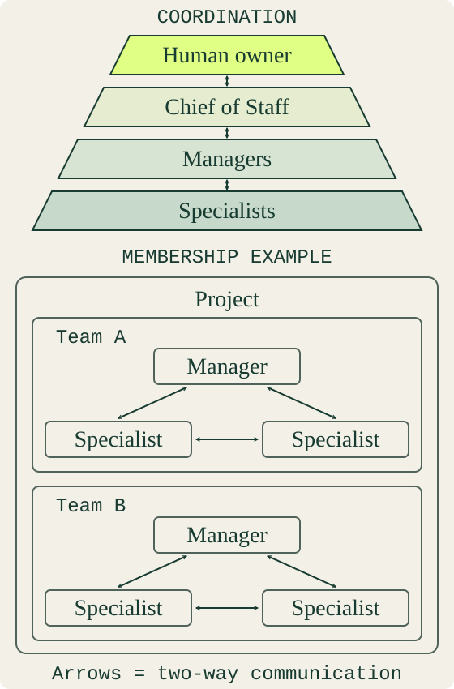

# Codex Bot Mode (CBM)

[English](README.md) · [Български](README.bg.md)

> Persistent agents and teams inside Codex Desktop: a Manager per team, a Project Director for multi-team projects, a personal Chief of Staff, shared memory and a local Office for team rooms.

Unofficial community project; not affiliated with or endorsed by OpenAI. "Codex" is the name of an OpenAI product.

## Why

Most multi-agent tools build a new environment: their own runtime, their own chat UI, their own permissions. Codex Desktop already has what an agent needs: chats that keep context, project folders, skills, plugins, connectors, sandboxed tools and your approval rules. CBM does not replace any of that. It adds structure on top of it:

- **Identity.** Each agent is an ordinary Codex chat that loads a profile (role, character, playbook, rules) and its own validated memory.
- **Teams.** Agents are grouped into teams with a Manager; projects with several teams get a Project Director; your Chief of Staff is the single entry point across projects.
- **Coordination.** A roster keeps every agent's current chat link; a request ledger makes sure every request gets a reply in the requester's channel, with reminders when it does not.
- **Memory that travels.** Learned lessons are evidence-backed files committed with your project, so they work on a second computer and for everyone on the team.

Nothing runs behind your back: work happens in your Codex chats, with your permissions, and appointments need your approval.

## How it works

The pyramid shows coordination; the adjacent outlined example shows membership.
A Team is a Manager plus specialists; a Project can contain multiple Teams.
The optional Chief of Staff connects the owner with each project's entry point.
For projects with two or more Teams, appoint a Project Director to coordinate
their Managers and act as the project entry point. This is a project policy,
not a fifth pyramid tier. Specialist communication stays within the team's scope;
the diagram grants no cross-project authority.

| Piece | What it is |
|---|---|
| Agent | A Codex chat + a workspace folder: `agent/BASE.md` (shared rules), `SOUL.md`, `PROFILE.md`, `PLAYBOOK.md`, `STATE.md`, `agent.yaml`, `memory/` |
| Team | Agents from a catalog template, a sidebar section and an Office room |
| Roster | `.bot-mode/roster.json` (shared) + `.bot-mode/local/bindings.json` (your chats) |
| Request ledger | `.bot-mode/local/requests.json`: every request waits for its reply |
| Codex Office | Local web app on http://localhost:24242: team rooms, personal chats, settings |

## Catalog

| Team | Roles |
|---|---|
| Development | Manager, Developer, Code Reviewer, Designer, Verifier |
| Marketing | Manager, Strategist, Content Writer, Content Reviewer |
| Sales (drafts only) | Manager, Lead Researcher, Outreach Writer, Pipeline Analyst |
| Any project | Project Director (two or more teams); custom roles from the blank template |
| Personal | Chief of Staff: your assistant and entry point across projects |

Each role is also available on its own. See [catalog/](catalog/README.md).

## Quick start

Requirements: Codex Desktop (Windows tested; other platforms untested), Python 3.10+ (standard library only), Git. Optional: GitHub CLI, Chrome or Edge for Office voice features.

1. Clone this repository.
2. Build and register the plugin: `python -B scripts/build_plugin.py`. In Codex open **Plugins > Personal** and install **Codex Bot Mode**.
3. Add your project folder in Codex, start a chat there and say: *"Start a Development team in this project."*
4. Choose defaults or answer the setup questions, review the plan, confirm. Your chat becomes the Manager; the other agents get their own chats in a sidebar section.
5. Give the Manager a task.

Choose a work tracking mode at appointment: GitHub, local, or both with one
authoritative status record. Task recording is mandatory in every mode. See
[Team work tracking](docs/design/team-work-tracking.md).

Step-by-step with expected results: [Getting started](docs/getting-started.md). Daily use: [Working with teams](docs/working-with-teams.md).

## Documentation

| Read | For |
|---|---|
| [Getting started](docs/getting-started.md) | First install and first team |
| [Working with teams](docs/working-with-teams.md) | Who to talk to, adding teams and agents, two computers |
| [Teams reference](docs/operations/teams.md) | Commands, approvals, structure |
| [Roster](docs/design/project-roster.md) | Shared and local parts, commands |
| [Catalog](catalog/README.md) | Templates and their parameters |
| [Chief of Staff](packages/chief-of-staff-v1/README.md) | Personal agent setup |
| [Documentation index](docs/00-index.md) | Canonical documentation index, marketing routes, and templates |
| [AGENTS.md](AGENTS.md) | Instructions for coding agents working on this repository |

## Status

Early (0.1). The design is tested with unit tests and live Codex Desktop runs on Windows. Expect changes; see [CHANGELOG.md](CHANGELOG.md).

## Contributing and security

[CONTRIBUTING.md](CONTRIBUTING.md) · [SECURITY.md](SECURITY.md) · [CODE_OF_CONDUCT.md](CODE_OF_CONDUCT.md)

## License

[MIT](LICENSE)
